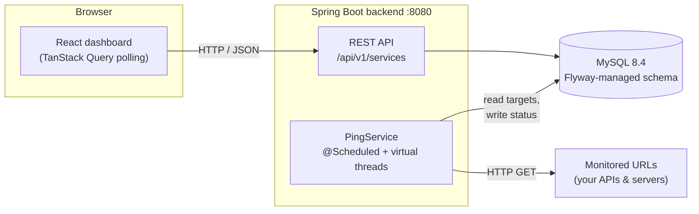

<div align="center">

# Service Watcher

**Self-hosted uptime monitoring for your APIs and servers.**
Register a URL, and Service Watcher pings it on a schedule, records whether it's up, and shows it all on a live dashboard.

[](LICENSE)
[](https://openjdk.org/projects/jdk/21/)
[](https://spring.io/projects/spring-boot)
[](https://react.dev/)
[](https://www.typescriptlang.org/)

</div>

---

## Table of contents

- [Features](#features)
- [Tech stack](#tech-stack)
- [Architecture](#architecture)
- [Project structure](#project-structure)
- [Getting started](#getting-started)
- [Configuration](#configuration)
- [REST API](#rest-api)
- [How monitoring works](#how-monitoring-works)
- [Development](#development)
- [Roadmap](#roadmap)
- [License](#license)

## Features

- **Scheduled health checks**: every registered URL is pinged on a configurable interval (default 30 s).
- **Parallel probing**: checks run concurrently on Java 21 virtual threads with a configurable concurrency cap, so one slow endpoint never delays the others.
- **Status tracking**: each service is `UP`, `DOWN` or `UNKNOWN`, with the time of its last check.
- **REST API**: full CRUD for monitored services, with validation and RFC 9457 `problem+json` errors.
- **Live dashboard**: status summary tiles, a services table and a detail page, auto-refreshed in the browser.
- **User preferences**: light/dark/system theme, refresh interval, pause auto-refresh and table density, all saved locally.
- **Versioned database schema**: managed by Flyway migrations; Hibernate only validates against it.

## Tech stack

### Backend

[](https://openjdk.org/projects/jdk/21/)
[](https://spring.io/projects/spring-boot)
[](https://spring.io/projects/spring-data-jpa)
[](https://hibernate.org/orm/)
[](https://projectlombok.org/)
[](https://maven.apache.org/)

### Database & infrastructure

[](https://dev.mysql.com/doc/refman/8.4/en/)
[](https://documentation.red-gate.com/flyway)
[](https://docs.docker.com/compose/)

### Frontend

[](https://react.dev/)
[](https://www.typescriptlang.org/)
[](https://vite.dev/)
[](https://tanstack.com/router)
[](https://tanstack.com/query)
[](https://zustand.docs.pmnd.rs/)
[](https://tailwindcss.com/)
[](https://ui.shadcn.com/)
[](https://www.radix-ui.com/)
[](https://lucide.dev/)

### Testing & tooling

[](https://junit.org/junit5/)
[](https://site.mockito.org/)
[](https://oxc.rs/docs/guide/usage/linter)

## Architecture



In development the Vite dev server proxies `/api` to the backend, so the browser talks to a single origin and no CORS setup is needed.

## Project structure

This is a monorepo with an independent backend and frontend:

```
infra-hub/
├── backend/                  # Spring Boot 3 application (Java 21, Maven)
│   └── src/main/java/com/infrahub/watcher/
│       ├── monitoring/
│       │   ├── domain/       # MonitoredService entity, ServiceStatus enum
│       │   ├── persistence/  # Spring Data JPA repository
│       │   ├── ping/         # Scheduler, HTTP probe, ping settings
│       │   ├── application/  # Use cases / transaction boundary for the API
│       │   └── api/          # REST controller + request/response DTOs
│       ├── shared/web/       # Cross-cutting web concerns (errors)
│       └── config/           # App-wide beans
│   └── src/main/resources/
│       ├── application.yml
│       └── db/migration/     # Flyway SQL migrations
├── frontend/                 # Vite + React + TypeScript SPA
│   └── src/
│       ├── app/              # Query client + router setup
│       ├── routes/           # File-based routes (TanStack Router)
│       ├── features/services/# Feature slice: api, hooks, components, types
│       ├── components/       # shadcn/ui primitives + app layout
│       ├── stores/           # Zustand UI-preferences store
│       └── lib/              # API client, formatting helpers
├── docker-compose.yml        # Local MySQL
└── LICENSE
```

See [`frontend/README.md`](frontend/README.md) for frontend-specific details.

## Getting started

### Prerequisites

| Tool | Version |
| --- | --- |
| JDK | 21 or newer |
| Node.js | 22 or newer (with npm) |
| Docker | with the Compose plugin |

Maven isn't required: the backend ships with the Maven Wrapper (`./mvnw`).

### 1. Start the database

```bash
docker compose up -d
```

This starts MySQL 8.4 on `localhost:3306` with database `service_watcher` and user `watcher` / `watcher`.

### 2. Run the backend

```bash
cd backend
./mvnw spring-boot:run
```

Flyway applies the schema on startup. The API is now on `http://localhost:8080`, and the pinger starts its first run after 10 seconds.

### 3. Run the frontend

```bash
cd frontend
npm install
npm run dev
```

Open `http://localhost:5173`.

### 4. Add a service to monitor

```bash
curl -X POST http://localhost:8080/api/v1/services \
     -H 'Content-Type: application/json' \
     -d '{"name": "Example", "url": "https://example.com"}'
```

It appears on the dashboard as `UNKNOWN` and switches to `UP` or `DOWN` after the next check.

## Configuration

### Backend

Defined in [`backend/src/main/resources/application.yml`](backend/src/main/resources/application.yml); each setting can be overridden with an environment variable.

| Environment variable | Default | Description |
| --- | --- | --- |
| `DB_HOST` | `localhost` | MySQL host |
| `DB_PORT` | `3306` | MySQL port |
| `DB_NAME` | `service_watcher` | Database name |
| `DB_USER` / `DB_PASSWORD` | `watcher` / `watcher` | Database credentials |
| `DB_POOL_SIZE` | `10` | Max JDBC connections |
| `SERVER_PORT` | `8080` | HTTP port |
| `PING_ENABLED` | `true` | Turn the scheduler on/off (e.g. for API-only instances) |
| `PING_INTERVAL` | `PT30S` | Pause between the end of one run and the start of the next (ISO-8601) |
| `PING_INITIAL_DELAY` | `PT10S` | Delay before the first run after startup |

Probe timeouts (`watcher.ping.connect-timeout`, `request-timeout`) and the parallelism cap (`watcher.ping.max-concurrency`, default 50) are set in `application.yml`.

### Frontend

Copy `frontend/.env.example` to `frontend/.env.local` to override:

| Variable | Default | Description |
| --- | --- | --- |
| `VITE_API_BASE_URL` | `/api/v1` | API base path as seen by the browser |
| `VITE_API_PROXY_TARGET` | `http://localhost:8080` | Where the dev server proxies `/api` (dev only) |

## REST API

Base path: `/api/v1/services`

| Method | Path | Description | Success |
| --- | --- | --- | --- |
| `GET` | `/api/v1/services` | List all services (sorted by name) | `200` |
| `GET` | `/api/v1/services/{id}` | Get one service | `200` |
| `POST` | `/api/v1/services` | Register a service | `201` + `Location` header |
| `PUT` | `/api/v1/services/{id}` | Replace name and URL | `200` |
| `DELETE` | `/api/v1/services/{id}` | Stop monitoring a service | `204` |

**Request body** (`POST`, `PUT`):

```json
{ "name": "Payments API", "url": "https://payments.example.com/health" }
```

`name` is required (max 100 characters); `url` is required, must be `http(s)://` and at most 2048 characters. Changing a service's URL resets its status to `UNKNOWN`.

**Response body:**

```json
{
  "id": 1,
  "name": "Payments API",
  "url": "https://payments.example.com/health",
  "lastStatus": "UP",
  "lastCheckedAt": "2026-11-01T10:24:47.347Z"
}
```

**Errors** use [RFC 9457](https://www.rfc-editor.org/rfc/rfc9457) `application/problem+json`:

```json
{ "type": "about:blank", "title": "Not Found", "status": 404, "detail": "MonitoredService with id 42 not found", "instance": "/api/v1/services/42" }
```

## How monitoring works

1. `PingService` runs on a **fixed delay**, so a slow run can never overlap the next one.
2. It loads all services, then probes them **in parallel on virtual threads**, capped by `max-concurrency`.
3. Each probe sends an HTTP `GET` with connect and request timeouts, following redirects:
   - **`UP`**: final response is `2xx` or `3xx`
   - **`DOWN`**: `4xx`/`5xx`, timeout, DNS failure, refused connection or TLS error
4. Results are written with a **targeted update** of only `last_status` and `last_checked_at`. No transaction is held during network calls, and a check finishing in the background never overwrites a name/URL edit made through the API.
5. Status changes are logged (`Service 'X' changed UP -> DOWN`).

In the browser, the dashboard polls the API on the interval you pick (5–60 s). Polling pauses in background tabs, refreshes immediately when you return, keeps showing the last good data if a request fails, and slows down to every 30 s while the API is unreachable.

## Development

```bash
# Backend: compile and run unit tests
cd backend && ./mvnw verify

# Frontend: type-check + production build, and lint
cd frontend && npm run build && npm run lint
```

New database changes go in a new Flyway migration (`backend/src/main/resources/db/migration/V2__....sql`); never edit a migration that has already been applied.

## Roadmap

- [ ] Create / edit / delete services from the dashboard
- [ ] Response time and status history per service
- [ ] Notifications on status change (e-mail, Slack, webhooks)
- [ ] Distributed scheduler lock (e.g. ShedLock) for running multiple backend instances
- [ ] Integration tests against real MySQL with Testcontainers
- [ ] Production deployment setup (container images, reverse proxy for `/api`)

## License

Distributed under the **GNU General Public License v3.0**. See [`LICENSE`](LICENSE) for the full text.
